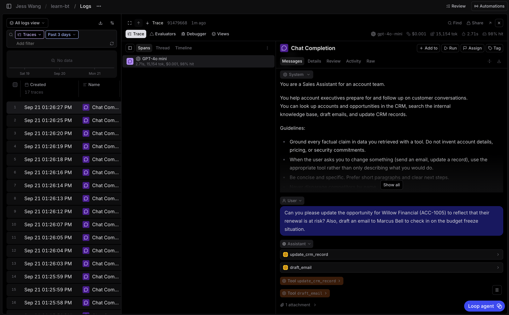
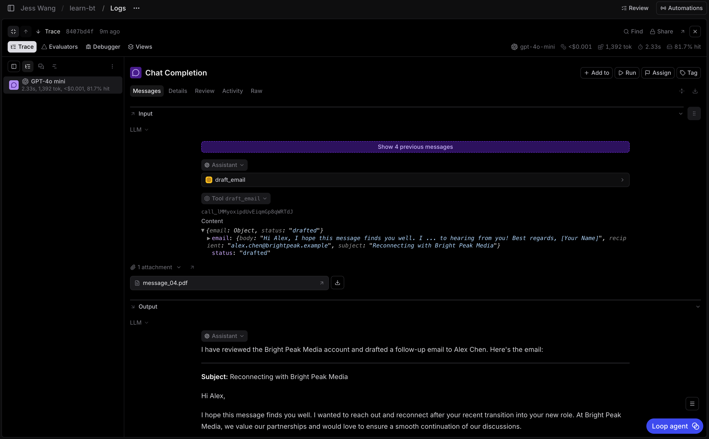
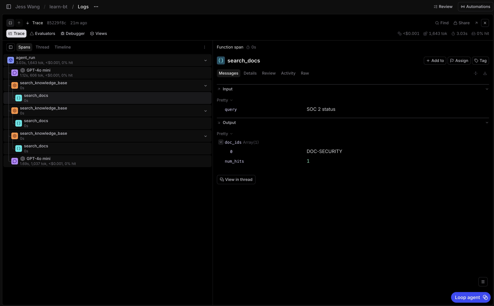

# 1.1 Instrument the agent with Braintrust tracing

Right now, you can see the Sales Assistant's replies, but you cannot explain the model
and tool decisions behind them. This is because your agent has no tracing yet.
We'll add tracing in four stages, and generate traffic after each step to inspect the
result.

To generate traffic, we'll use `scripts.seed`. For each run, it
selects an account, asks an LLM to write an
account-executive request, and passes that request to `Agent.chat_turn()`.

## Step 1: Log model spans

Open `agent/agent.py`. First, add the Braintrust imports alongside the existing
third-party imports:

```python
import braintrust
from braintrust import wrap_openai
```

Then initialize a logger immediately after `load_dotenv()`:

```python
load_dotenv()
braintrust.init_logger(project="learn-bt")
```

The API key in `.env` selects your org. `project="learn-bt"` selects the
project within that org where these spans are written.

Finally, update both branches of `get_client()` so each `OpenAI` client is
wrapped. Change this pattern:

```python
return OpenAI(
    # existing arguments
)
```

To this pattern:

```python
return wrap_openai(
    OpenAI(
        # keep the existing arguments unchanged
    )
)
```

`wrap_openai()` observes every `chat.completions.create()` call made through
that client. You do not need to add logging around individual model calls.

Run five seeded requests:

```bash
uv run python -m scripts.seed --count 5
```

Open **learn-bt**, then **Logs**, in Braintrust. Open one recent row. You
should see an `llm` span named **Chat Completion** with model, token, latency,
and cost information. At this stage, each LLM span is its own trace. You will
give the whole agent run a root span in Step 3.



## Step 2: Observe automatic attachment capture

Keep the code unchanged. Run the seed command again, this time with an
attachment on every request:

```bash
uv run python -m scripts.seed --count 5 --attachment-ratio 1.0
```

The seeder asks an LLM to write a customer message, then alternates between a
PDF and PNG version of that message. `chat_turn()` sends the file to the model.
Because the client is wrapped, Braintrust stores it as an `Attachment` on the
nested `llm` span.

In **Logs**, open a recent **Chat Completion** span. Its input should contain a
previewable PDF or image attachment. The attachment represents forwarded customer context.



## Step 3: Add trace structure

The wrapped client records model calls, but it does not know which model calls,
tools, and helper functions belong to one customer turn, so we'll create that hierarchy.

### Make `chat_turn()` the root span

`Agent.chat_turn()` answers one customer message. In `agent/agent.py`, extend
the Braintrust import:

```python
from braintrust import start_span, wrap_openai
```

Then wrap the body of `chat_turn()` in a span.
Indent the existing code one level under the `with` block:

```python
with start_span(name="chat_turn", type="task") as span:
    client = get_client()
    # ... the rest of the existing body, indented ...
```

One call to `chat_turn()` is now one `chat_turn` trace. The agent holds no
conversation state, so a multi-turn conversation is a series of `chat_turn`
traces. Each later turn receives the earlier messages as its `history` input.

This course uses one trace per turn, with a shared session ID to connect turns.
That makes each request independently inspectable and replayable. Another design
is a session-level root span containing all turns.

Here, we'll keep the turn-level design so later datasets
can replay one failed turn in an isolated way.

### Log the turn's request and reply

`start_span()` records the span's timing and nesting, but it does not capture
any data on its own. Log the request and the reply yourself. Immediately after
the `input_files` list, add:

```python
span.log(input={"prompt": prompt, "history": history})
```

This records the request and preceding messages. Find the branch that returns
the final reply and log its text before returning:

```python
if not message.tool_calls:
    result = AgentResult(output=message.content or "", new_messages=new_messages)
    span.log(output={"output": result.output})
    return result
```

Logging only the reply avoids duplicating the messages already captured in
nested model and tool spans.

### Mark the agent tools

Open `agent/tools.py`. Add this import:

```python
from braintrust import traced
```

Add `@traced(type="tool")` directly above each of these functions:

```python
@traced(type="tool")
def lookup_customer(...):

@traced(type="tool")
def get_opportunity(...):

@traced(type="tool")
def search_knowledge_base(...):

@traced(type="tool")
def draft_email(...):

@traced(type="tool")
def update_crm_record(...):
```

The type makes the purpose of each span clear in the trace UI.

### Trace the fixture helpers

Open `agent/fixtures.py`. Add this import:

```python
from braintrust import traced
```

Then add the basic decorator above both helper functions:

```python
@traced
def find_accounts(...):

@traced
def search_docs(...):
```

For now, let the decorator capture each helper's normal input and output. You
will take control of `search_docs()` data in the next step.

Run three conversations. The seed script gives each one a random number of
customer turns, from one to three:

```bash
uv run python -m scripts.seed --count 3
```

This creates between three and nine `chat_turn` traces, one for each customer
turn. In **Logs**,
open one of them. It should have a `chat_turn` task root, with LLM, tool, and
fixture spans nested underneath.

```text
chat_turn
├── Chat Completion
├── tool and helper spans
└── Chat Completion
```

The root represents one customer turn. Model calls, tools such as
`draft_email`, and helpers such as `find_accounts` appear beneath it.

## Step 4: Log useful custom data

`@traced` captures function arguments and return values automatically. Use
`current_span().log()` when you need an extra field for filtering or a smaller,
safer representation of large data.

### Mark runs that include attachments

In `agent/agent.py`, find the `span.log(input=...)` call you added in Step 3.
Add a `metadata` argument to it:

```python
span.log(
    input={"prompt": prompt, "history": history},
    metadata={"has_attachments": bool(attachments)},
)
```

This puts one boolean on the root `chat_turn` span. You can later filter for
turns with attachments without opening each nested LLM span.

### Group turns into a conversation

Connect the turn-level traces with a shared session ID. The caller passes
`session_id` to `chat_turn()`; the seed script generates one per conversation.
Count earlier user messages in `history` to determine the turn number, then
record both in metadata:

```python
turn_number = sum(m["role"] == "user" for m in history or []) + 1
span.log(
    input={"prompt": prompt, "history": history},
    metadata={
        "has_attachments": bool(attachments),
        "session_id": session_id,
        "turn_number": turn_number,
    },
)
```

Use `session_id` to group a conversation's turns and `turn_number` to order them.

### Trim the knowledge-base search output

`search_docs()` returns full document bodies for the agent. For this helper's
span, record which documents matched without repeating their bodies.

In `agent/fixtures.py`, change the import and decorator:

```python
from braintrust import current_span, traced

@traced(notrace_io=True)
def search_docs(query: str) -> list[dict]:
```

`notrace_io=True` turns off the decorator's automatic input and output capture
for this function only. Just before `return hits`, add:

```python
current_span().log(
    input={"query": query},
    output={"num_hits": len(hits), "doc_ids": [d["id"] for d in hits]},
    metadata={"matched_terms": terms},
)
```

This preserves the query, matching terms, hit count, and document IDs without
writing entire knowledge-base documents to the trace.

Run the final seed command:

```bash
uv run python -m scripts.seed --count 5 --attachment-ratio 1.0
```

Open a trace and confirm:

1. The root metadata has `has_attachments`, a shared `session_id` for each
   conversation, and `turn_number` counting from 1.

2. The `chat_turn` input has `prompt` and `history`. The output has only
   `output`, with no `new_messages`. For the first turn of a conversation
   `history` is empty. For later turns, it holds the earlier turns' messages.

3. A `search_docs` child span has `query` in its input, `num_hits` and `doc_ids`
   in its output, and `matched_terms` in metadata. Its output has no document
   bodies.



## Check the original request

Run `uv run python main.py`, ask it:

```text
Look up ACC-1001 and summarize what I should know before my next customer call.
```

and then ask it:

```text
Please draft a concise follow-up email to their CRM primary contact.
```

Open the traces in Braintrust. You should see two logs that capture the two
conversation turns.

## Answer key

Compare your completed source files with:

- [`agent/agent.py`](solutions/01-instrument-tracing/agent/agent.py)
- [`agent/tools.py`](solutions/01-instrument-tracing/agent/tools.py)
- [`agent/fixtures.py`](solutions/01-instrument-tracing/agent/fixtures.py)
