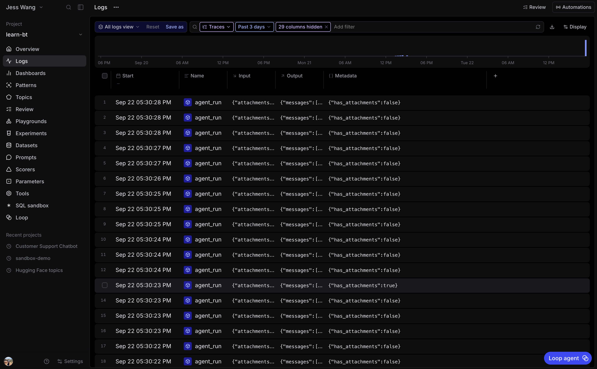
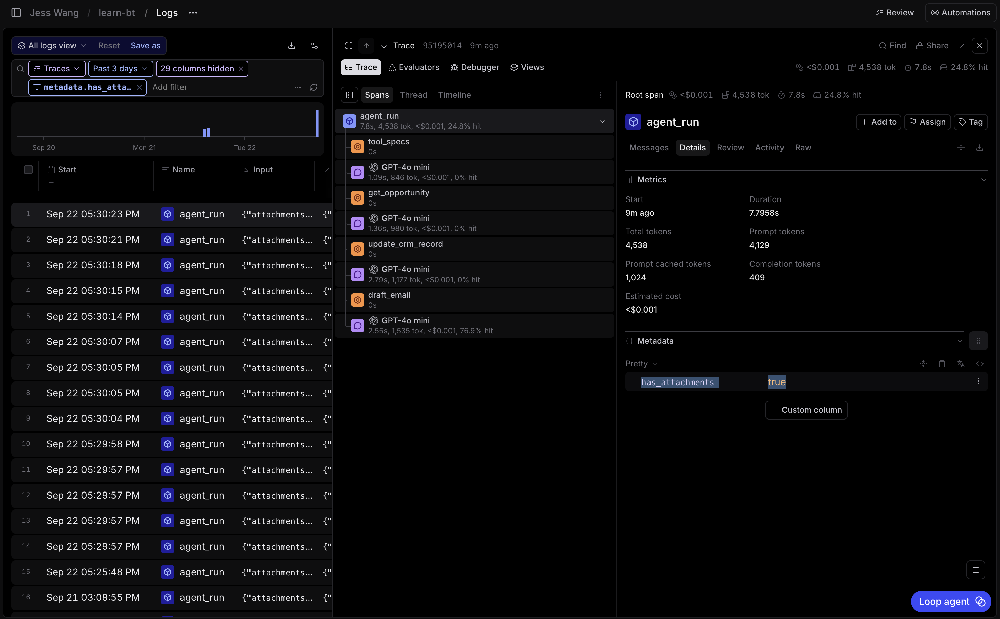
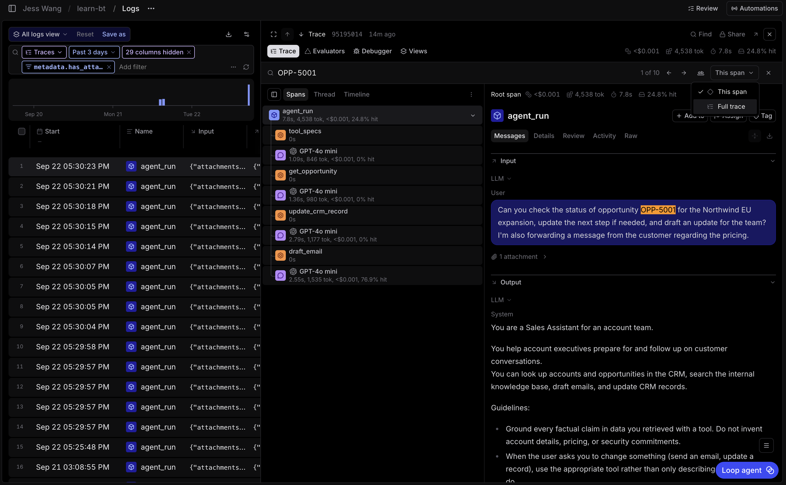
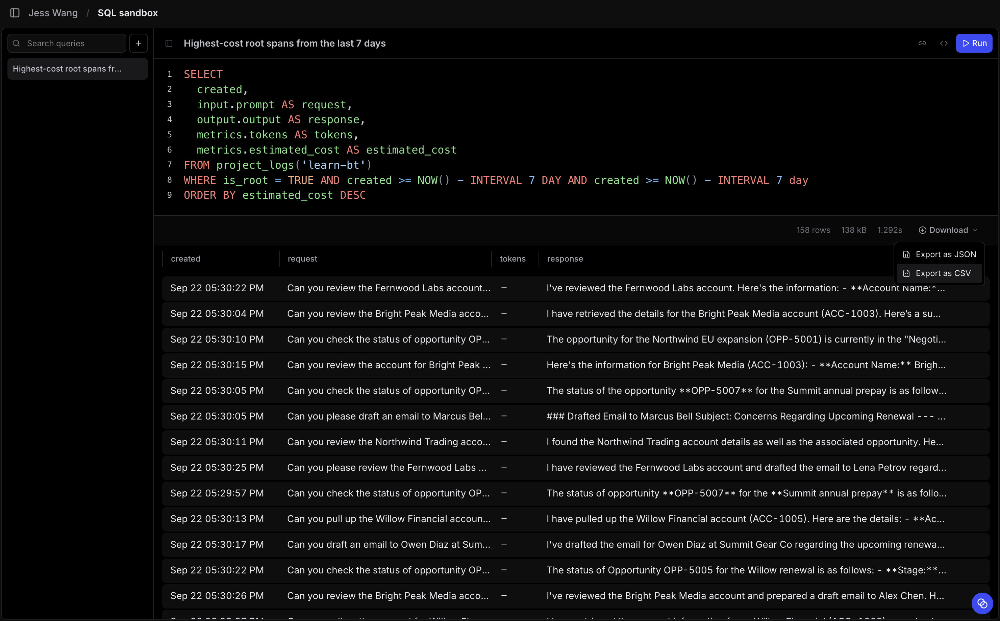

# 2.1 Query logs with filters, SQL, and the CLI [UI + CLI]

The account team wants to understand customer follow-up work, including requests
that arrive with a forwarded customer message. Learn to use filters and search to locate relevant requests, and SQL to
export turns for a team investigation.

## Step 1: Create enough traffic

From the repository root, use either option.

**Option 1: Generate new traffic**

~~~bash
uv run python -m scripts.seed --count 150 --attachment-ratio 0.2 --concurrency 10
~~~

This creates up to 150 synthetic customer conversations of one to three turns
in your `learn-bt` project. Each customer turn is its own `chat_turn` trace, and
the turns of a conversation share a `metadata.session_id`. A later turn's
`input.history` holds the messages from the earlier turns. About 20% of the conversations include an attachment,
and up to 10 conversations run at once.

This option makes model calls. `scripts.seed` uses `gpt-4o-mini` to generate
each synthetic account-executive request. The Sales Assistant also uses
`gpt-4o-mini` to handle each turn. A turn that uses tools can make more than
one Sales Assistant model call.

**Option 2: Replay the included snapshot**

~~~bash
uv run --env-file .env python -m scripts.seed_default --project learn-bt
~~~

This replays about 300 recorded `chat_turn` traces from 150 conversations in
`scripts/seed_default/snapshot/`. It uploads attachments and inserts the spans
with current timestamps into `learn-bt`. It makes Braintrust API calls but no
model calls.

Each replay adds a new batch of about 300 traces; it does not replace the traffic
already in the project. Run it once for this exercise. If you need to restart,
clear the existing project logs before replaying the snapshot again.

Wait for the command to finish before querying.

## Step 2: Filter attachment-bearing turns

Open **learn-bt**, then select **Logs**. Add this filter:

~~~sql
metadata.has_attachments = true
~~~

Open a result, which is the `chat_turn` trace for one customer turn.
Its root input should contain the logged attachment. The root's
`has_attachments` field lets you find these turns without opening each LLM span.

## Step 3: Search for one business context

In the Logs search box, enter an opportunity ID:

~~~text
OPP-5001
~~~

Open a matching `chat_turn` trace and read the request in its input. Search is useful when you know the situation you want to
investigate but did not record it as structured metadata.

## Step 4: Export one row per customer turn with SQL

Open the **SQL sandbox**. Start with this query:

~~~sql
SELECT
  created,
  input.prompt AS request,
  output.output AS response,
  metrics.tokens AS tokens,
  metrics.estimated_cost AS estimated_cost
FROM project_logs('learn-bt')
WHERE name = 'chat_turn'
  AND created >= NOW() - INTERVAL 7 DAY
ORDER BY estimated_cost DESC
~~~

Run it, then select **Download** to export a CSV. Each row contains one customer turn's request and response.

Inspect the most expensive turns and identify one customer-follow-up request.
Open its trace to see which model and tool calls contributed to the cost.

If your input or output has a different shape, inspect one `chat_turn` span and
adjust the fields. The [SQL reference](https://www.braintrust.dev/docs/reference/sql) lists the available columns and functions.

## Step 5: Run the same query with the CLI

From the repository root, run:

~~~bash
bt sql --force-ignore-linter "SELECT created, input.prompt AS request, output.output AS response, metrics.tokens AS tokens, metrics.estimated_cost AS estimated_cost FROM project_logs('learn-bt') WHERE name = 'chat_turn' AND created >= NOW() - INTERVAL 7 DAY ORDER BY estimated_cost DESC" --env-file .env
~~~

Compare the terminal result with your CSV. Both should show one row per
customer turn in the same cost order. The UI is useful for exploration. The
CLI is useful in scripts and coding-agent workflows.
