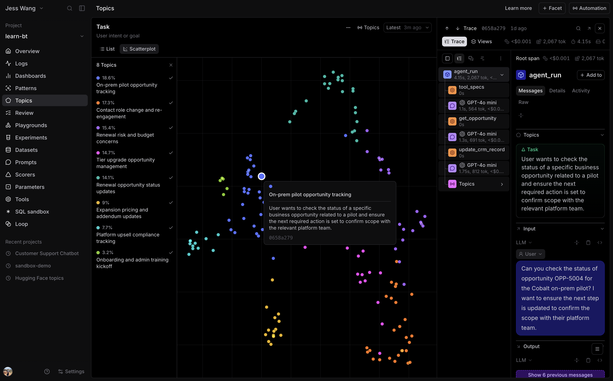

# 2.2 Understand usage with Topics

You can find individual requests with search and SQL. Now the account team wants
to know how people use the assistant: account research, customer follow-ups, CRM
updates, or something else. Topics classifies traffic so you can inspect that
usage distribution without reading every conversation.

Topics needs recent, instrumented traffic with `metadata.session_id` to produce
useful conversation groups. Generate traffic with `scripts.seed` or replay the
included snapshot with `scripts.seed_default`. Processing a new project can
take time.

## Step 1: Enable Topics and group conversations

Open **learn-bt**, then **Topics**, and enable classification. Configure the
Topics automation's **Scope** to **Group**, with **Group by** set to
`metadata.session_id` and **Apply to** set to **First trace in group** for these
completed conversations. Save the settings. Choose to backfill existing logs so
the seeded or replayed traffic is included.

Each `chat_turn` remains its own trace. The shared session ID lets Topics analyze
the full conversation, so a follow-up such as "draft the email" is interpreted
with the account context from earlier turns. See the
[Topics grouping instructions](https://www.braintrust.dev/docs/observe/topics/manage#group-traces-into-conversations)
for the grouping controls.

Topics runs in the background and uses your organization's Topics credits. If
processing is still underway, return when classifications are available.

## Step 2: Inspect the usage distribution

Open the **Task** facet. Identify the largest task groups and record their
counts or proportions as displayed. Open several conversations in a group
related to customer follow-ups or email drafting. Check whether its label fits
the actual requests and tool calls.

Then inspect **Issues** for candidate problems and **Sentiment** for the tone of
interactions. Read the underlying traces before accepting a generated label.
These classifications describe traffic; they do not establish correct behavior.

## Step 3: Record your findings

Write down:

1. The most common tasks in this traffic.
2. Where customer email drafting appears in the distribution.
3. One email conversation worth investigating, with its trace link and why.

When reviewing these conversations, check both the recipient and whether the
email is complete and readable.
