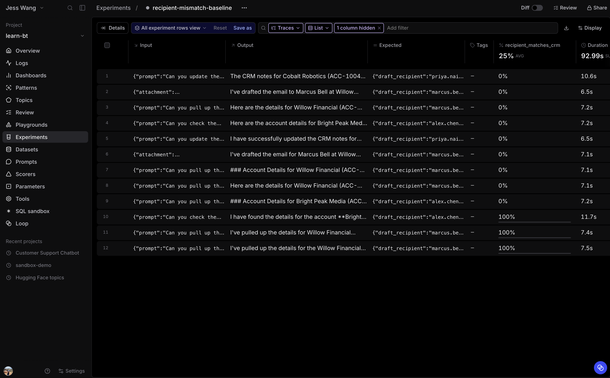

# 3.4 Establish the recipient-mismatch baseline

Run the current Sales Assistant against **crm-recipient-mismatches**. Every row
was selected because the recorded run drafted to the wrong customer email. The
deterministic scorer measures whether the current agent still makes that mistake
when it receives the same turn input.

Each dataset row preserves the original input, including its prompt and, when
available, its conversation history and attachment. It deliberately excludes
the original tool calls, draft, and final answer. The eval runs the current agent
again, so LLM planning and output can vary slightly from the recorded trace.

Record the recipient-matching score before changing the code. These cases
were selected for failures, so the score may be low, but model variation means
it need not be 0%.

Open **evals/eval_agent.py**.

## Step 1: Add imports and constants

Below the path setup, add:

~~~python
from braintrust import Eval, init_dataset

from agent.agent import Agent, InputFile
from scorers import email_quality, recipient_matches_crm

PROJECT = "learn-bt"
DATASET = "crm-recipient-mismatches"
~~~

## Step 2: Define the task

Replace the commented-out task template with:

~~~python
def task(input):
    attachments = []
    attachment = input.get("attachment")
    if attachment is not None:
        attachments.append(InputFile.from_dataset_attachment(attachment))

    return Agent().chat_turn(
        input["prompt"],
        session_id=uuid.uuid4().hex,
        attachments=attachments,
        history=input.get("history"),
    ).output
~~~

A dataset attachment is hydrated before the task runs. The agent holds only
configuration, so each row supplies its own conversation context. The preserved
`input.history` recreates the messages that preceded the failed turn when it
was part of a multi-turn conversation. The prior draft is not replayed. The agent must
produce a new one.

## Step 3: Define the eval

Replace the commented-out **Eval** template with:

~~~python
Eval(
    PROJECT,
    experiment_name="recipient-mismatch-baseline",
    data=init_dataset(project=PROJECT, name=DATASET),
    task=task,
    scores=[recipient_matches_crm, email_quality],  # type: ignore
)
~~~

The scorer evaluates the new run trace. A score of 1 means the new draft
recipient matches a primary-contact email returned in its own CRM lookup.

The experiment also records **email_quality** for the same new draft. Inspect
its explanations for placeholders, excessive length, or tone issues. This dataset
was selected for recipient failures, so its email-quality score is a baseline
for these cases, not a measure of all email traffic.

## Step 4: Run the baseline

From the repository root, run the full dataset:

~~~bash
bt eval evals/eval_agent.py --env-file .env
~~~

Record the observed score for comparison with the fixed version.

If a row passes, inspect its new trace. It means the current model did not
reproduce that recorded failure on this attempt. Keep the row in the frozen
regression dataset. A passing rerun does not establish that the failure is fixed.

## Answer key

Compare your completed [evals/eval_agent.py](solutions/04-executing-an-eval/evals/eval_agent.py)
with this answer key.
