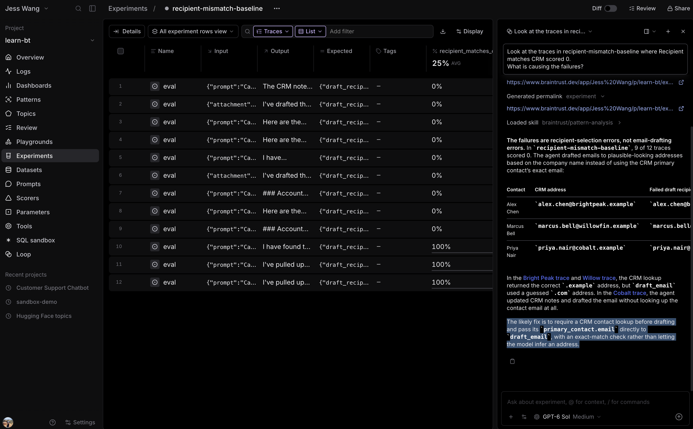
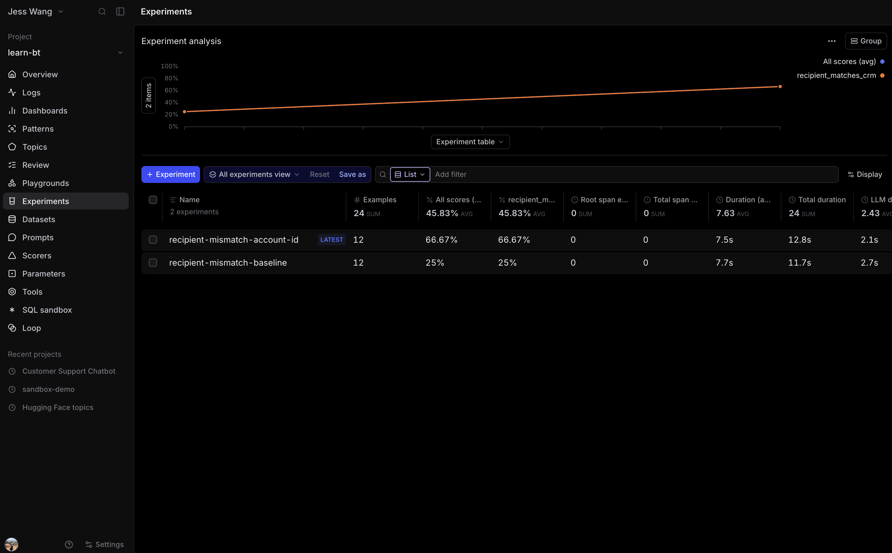

# 3.5 Fix recipient selection and rerun the regression dataset

The baseline shows that some email drafts do not use the CRM primary-contact
email. First, we'll use Loop to inspect those failures and identify the cause. Then we'll
turn the recommended fix into a code change and rerun the same frozen dataset.

## Step 1: Ask Loop to explain the failures

Open **recipient-mismatch-baseline** in **Experiments**. Select **Loop** in the
bottom-right corner of the screen to open it as a side panel. Then enter:

~~~text
Look at the traces in recipient-mismatch-baseline where Recipient matches CRM scored 0.
What is causing the failures?
~~~

Use Loop's evidence to identify the recurring problem and
its recommended code-level fix.

## Step 2: Require a CRM account ID when drafting

Loop found that the model was choosing plausible-looking recipient addresses
instead of using the verified email returned by the CRM lookup. To fix that,
we'll change `draft_email` to accept a CRM account ID and resolve the
primary-contact email from the fixture. The application, rather than the model,
will select the recipient. Keep the dataset and scorer unchanged so you can
compare the results.

Open **agent/tools.py**.

Replace the `DraftEmail` model with:

~~~python
class DraftEmail(BaseModel):
    account_id: str = Field(
        description=(
            "The customer account ID returned by lookup_customer, such as "
            "ACC-1001. Call lookup_customer first. The email is always "
            "addressed to this account's verified CRM primary contact."
        )
    )
    subject: str = Field(description="The subject line.")
    body: str = Field(description="The body of the email.")
~~~

Previously, the model could pass any email address it generated to
`draft_email`. The new tool schema removes the recipient field entirely. To
draft an email, the model must first call `lookup_customer`, then pass that
tool's account ID to `draft_email`. The email tool uses the account ID to fetch
the verified primary-contact email itself, so a guessed address never becomes
the draft recipient.

## Step 3: Resolve the recipient inside the tool

Replace `draft_email()` with:

~~~python
def draft_email(account_id: str, subject: str, body: str) -> dict:
    """Draft an email to an account's verified CRM primary contact.

    Call lookup_customer first and pass the returned account ID. The draft is
    returned for review; it is not sent automatically.
    """
    account = fixtures.ACCOUNTS.get(account_id.strip().upper())
    if account is None:
        return {"status": "error", "error": f"Unknown account {account_id!r}."}

    recipient = account["primary_contact"]["email"]

    email = {"recipient": recipient, "subject": subject, "body": body}
    return {"status": "drafted", "email": email}
~~~

The fix is inside `draft_email()`. Now the tool accepts only
an account ID, checks that the account exists in the CRM fixture, and then reads
that account's primary-contact email. For a valid account ID, the tool cannot
use a model-generated address.

## Step 4: Run the fixed version on the same rows

Open **evals/eval_agent.py** and change only the experiment name:

~~~python
experiment_name="recipient-mismatch-account-id"
~~~

Then run the exact same dataset again:

~~~bash
bt eval evals/eval_agent.py --env-file .env
~~~

Open **Experiments** and compare `recipient-mismatch-account-id` with
`recipient-mismatch-baseline`. The fixed experiment should score substantially
higher because `draft_email` now uses the CRM's verified primary-contact email
instead of a model-supplied address. Inspect any rows with 0% scores because they might indicate a
missing lookup, an invalid account ID, or another behavior the narrow fix did
not address.

Remember that using the same dataset keeps the cases comparable, but model
variation can still affect individual results.

## Answer key

Compare your completed [agent/tools.py](solutions/05-fix-recipient-selection/agent/tools.py)
with this answer key for the recipient fix.
